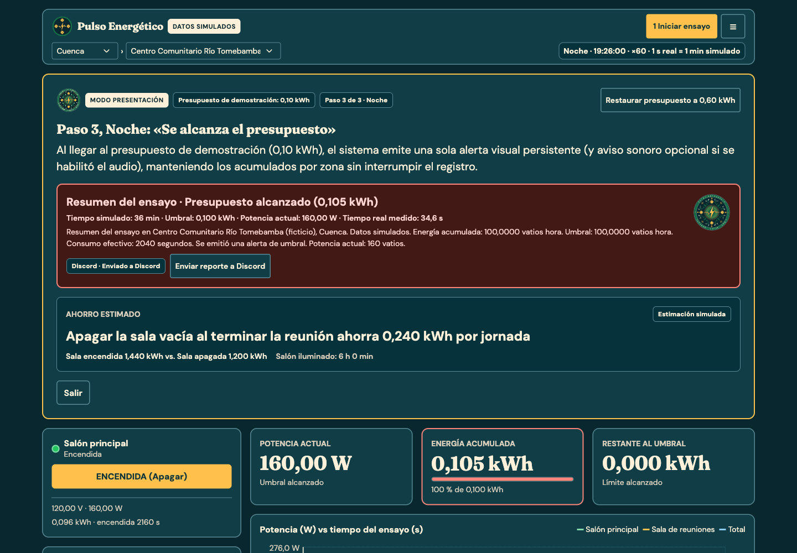
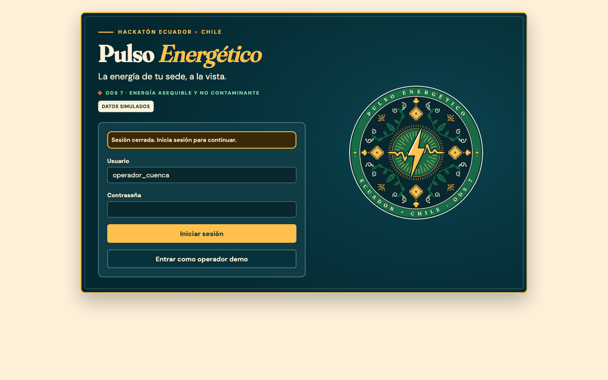
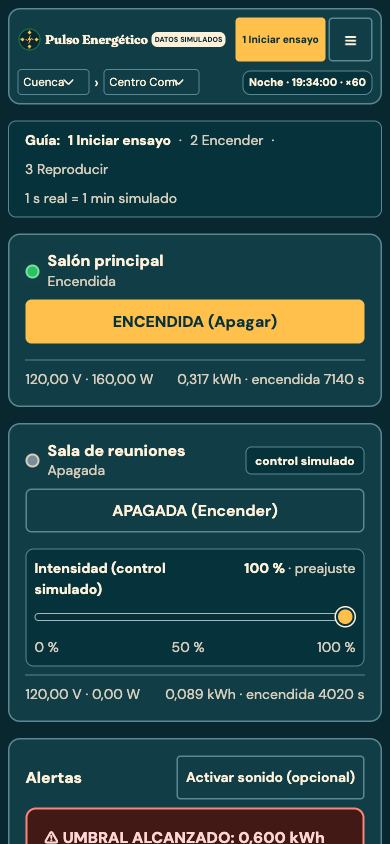
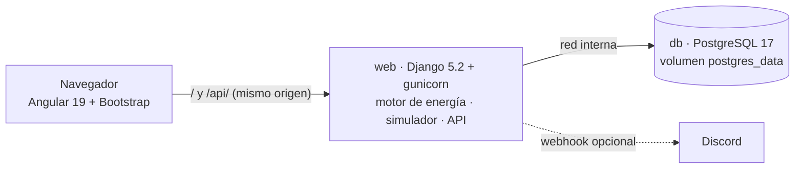
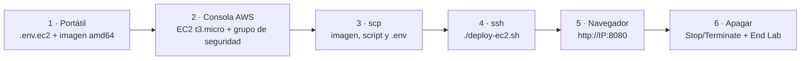

<p align="center">
  
</p>

<h1 align="center">
  
  Pulso Energético
</h1>

<p align="center">
  <b>La energía de tu sede, a la vista.</b><br>
  Prototipo para la Hackatón Ecuador × Chile · ODS 7 «Energía asequible y no contaminante»
</p>

<p align="center">
  
  
  
  
  
  
  
</p>

---

## ¿Qué es?

Pulso Energético ayuda al encargado de una **sede comunitaria** a responder tres preguntas:

| | Pregunta | Qué muestra la app |
|:-:|---|---|
| 💡 | **¿Qué está encendido?** | Cada zona con su luz, texto y botón de encendido |
| ⚡ | **¿Cuánta energía llevo?** | Potencia actual (W) y energía acumulada (Wh o kWh) |
| 🎯 | **¿Cuánto me falta para el límite?** | Energía restante, tiempo estimado y una alerta única al llegar |

Incluye dos localidades, **Cuenca (Ecuador)** y **Puente Alto (Chile)**. Cada una tiene un *banco de pruebas de 5 V* y una *sede ficticia* con salón principal y sala de reuniones.

> [!NOTE]
> Todos los datos son **simulados** y la pantalla lo indica. Los beneficios de ahorro y climáticos (ODS 13) son **hipótesis por validar**.

<p align="center">
  
  <br><sub>Modo presentación (Día → Tarde → Noche): alerta de presupuesto, resumen del ensayo, envío a Discord y ahorro estimado.</sub>
</p>

<table>
  <tr>
    <td width="62%"></td>
    <td width="38%"></td>
  </tr>
  <tr>
    <td align="center"><sub>Inicio de sesión con la identidad «Sello Cartel Latino»</sub></td>
    <td align="center"><sub>Vista móvil (390 px)</sub></td>
  </tr>
</table>

## Funciones

- **Control por zona:** salón (160 W), sala regulable (80 W) y carga de 5 V con perilla de 0 a 0,80 A.
- **Tres cifras grandes y dos gráficos:** potencia en el tiempo, y energía acumulada con línea de umbral.
- **Una sola alerta por ensayo**, visible aunque el audio esté silenciado. La carga no se apaga sola.
- **Día, tarde y noche** con un reloj de escenario. La sede avanza a ×60 (1 s real = 1 min simulado).
- **Modo presentación** guiado de 3 pasos (~35 s hasta la alerta) y **tarjeta de ahorro**: «apagar la sala vacía ahorra 0,240 kWh por jornada».
- **Estado persistente:** refrescar, abrir otra pestaña o reiniciar Docker muestra el mismo ensayo.
- **Discord (opcional):** la alerta y el reporte se publican en un canal mediante webhook.
- **Permisos:** operadores por localidad, operador de demo y observador de solo lectura.

## Cómo funciona



La energía **siempre** se calcula en el servidor:

```text
Potencia (W)               = tensión (V) × corriente (A)
Energía del intervalo (Wh) = potencia anterior (W) × segundos / 3600
```

Las lecturas repetidas no suman dos veces. Las que llegan fuera de orden no se integran. Un corte de conexión queda marcado «sin datos», sin consumo inventado.

---

## 🚀 Montaje local

### Requisitos

| | Ubuntu 22.04 / 24.04 | Windows 10 / 11 |
|---|---|---|
| Docker | Docker Engine + plugin Compose ≥ 2.24 | **Docker Desktop** con backend WSL 2 |
| Git | `sudo apt install git` | [Git for Windows](https://git-scm.com/download/win) |
| Python 3 (solo para la prueba de aceptación) | viene instalado | `winget install Python.Python.3.12` |
| RAM libre | ~2 GB | ~3 GB (Docker Desktop consume más) |

<details open>
<summary><b>🐧 Ubuntu</b></summary>

```bash
# 1) Docker (si no lo tienes)
sudo apt update && sudo apt install -y ca-certificates curl git
curl -fsSL https://get.docker.com | sudo sh
sudo usermod -aG docker $USER && newgrp docker      # usar docker sin sudo

# 2) Clonar
git clone https://github.com/datmetalpls/PulsoEnergetico.git
cd PulsoEnergetico

# 3) Levantar (la primera vez descarga imágenes y compila: 3–6 min)
docker compose up --build -d

# 4) Comprobar
docker compose ps                         # db (healthy) y web (Up)
curl -s -o /dev/null -w "%{http_code}\n" http://localhost:8080/   # 200
```
</details>

<details>
<summary><b>🪟 Windows (PowerShell)</b></summary>

1. Instala **Docker Desktop**, ábrelo y espera a que diga *Engine running*. Si te lo pide, activa WSL 2 con `wsl --install` y reinicia.
2. En **PowerShell**:

```powershell
# Clonar
git clone https://github.com/datmetalpls/PulsoEnergetico.git
cd PulsoEnergetico

# Levantar (la primera vez descarga imágenes y compila: 3–8 min)
docker compose up --build -d

# Comprobar
docker compose ps
(Invoke-WebRequest http://localhost:8080/ -UseBasicParsing).StatusCode   # 200
```

> [!TIP]
> El repositorio fuerza saltos de línea LF en los scripts (`.gitattributes`). Si aun así el contenedor falla con `entrypoint.sh: not found` o `\r`, vuelve a clonar con `git clone --config core.autocrlf=false …` y ejecuta `docker compose up --build -d`.
</details>

### Abrir la demo

1. Entra en **http://localhost:8080** y pulsa **«Entrar como operador demo»**. Este botón solo aparece en localhost.
2. Elige **Cuenca › Centro Comunitario Río Tomebamba**.
3. Abre el menú **☰ → Modo presentación** y pulsa **«Siguiente paso»** tres veces: Día → Tarde → Noche.
4. Al terminar, pulsa **«Restaurar presupuesto a 0,60 kWh»** y luego **«Salir»**.

| Usuario | Contraseña (solo demo local) | Puede |
|---|---|---|
| `operador_demo` | `Demo-2026` | Operar Cuenca y Puente Alto |
| `operador_cuenca` | `Cuenca-demo-2026` | Operar Cuenca |
| `operador_puente` | `Puente-demo-2026` | Operar Puente Alto |
| `observador` | `Observador-demo-2026` | Solo mirar |

> [!WARNING]
> Estas contraseñas son **públicas** (vienen de `.env.example`). Sirven solo en tu máquina. En cualquier servidor usa un `.env` propio, como se explica en la sección de AWS.

### Uso diario

| Acción | Comando (igual en Ubuntu y Windows) |
|---|---|
| Arrancar (también **sin Internet**) | `docker compose up -d` |
| Detener sin borrar datos | `docker compose stop` |
| Ver logs | `docker compose logs -f web` |
| Reconstruir tras cambiar código | `docker compose up --build -d` |
| Cargar un ensayo de respaldo precargado | `docker compose exec web python manage.py load_backup_demo` |
| ⛔ **Nunca**, porque borra la base de datos | `docker compose down -v` |

### Pruebas

```bash
# Ubuntu
docker compose exec -T web python manage.py test
python3 -I scripts/acceptance.py .env.example contracts/telemetry.example.json   # → 19/19 PASS
```
```powershell
# Windows
docker compose exec -T web python manage.py test
py -I scripts\acceptance.py .env.example contracts\telemetry.example.json        # → 19/19 PASS
```

### Discord (opcional)

Crea un archivo `.env` en la raíz del repositorio. Git lo ignora.

```bash
DISCORD_WEBHOOK_URL=https://discord.com/api/webhooks/…   # URL de tu webhook
```

Luego ejecuta `docker compose up -d --force-recreate web`. La app pasa de «Simulación local» a «Discord configurado». Todos los detalles están en [`docs/09-discord.md`](docs/09-discord.md).

> [!CAUTION]
> La URL del webhook es un **secreto**: quien la tenga puede publicar en tu canal. Nunca la subas al repositorio.

---

## ☁️ Despliegue en AWS (EC2, Learner Lab)

Una sola instancia EC2 corre **el mismo Docker Compose**. La imagen se compila **en tu portátil** y se copia a la instancia, porque una t3.micro (1 GB) no aguanta la compilación de Angular.



> [!IMPORTANT]
> **Learner Lab:** 50 USD en total y sesiones de 4 h. La IP pública **cambia** en cada arranque. **Nunca pulses *Reset***, porque borra toda la cuenta. Anota «Used $X of $50» al empezar y al terminar.

### Paso 1 · Preparar en el portátil (sin gastar sesión)

**¿Desde Windows?** Usa una terminal **Ubuntu en WSL** (`wsl --install -d Ubuntu`) para este paso y los siguientes. Así los comandos son idénticos a los de Ubuntu: `gzip`, `chmod`, `ssh` y `scp`. Docker Desktop se integra con WSL sola (*Settings → Resources → WSL integration*).

```bash
cd PulsoEnergetico

# 1. .env de producción: NO se sube a git
cp .env.example .env.ec2
python3 -c "import secrets;print(secrets.token_urlsafe(50))"   # → pega en DJANGO_SECRET_KEY
python3 -c "import secrets;print(secrets.token_urlsafe(24))"   # → pega en POSTGRES_PASSWORD
nano .env.ec2
#   Cambia DJANGO_SECRET_KEY, POSTGRES_PASSWORD y las 4 contraseñas:
#   DEMO_CUENCA_PASSWORD, DEMO_PUENTE_PASSWORD, DEMO_OBSERVER_PASSWORD, DEMO_OPERATOR_PASSWORD
#   (opcional) DISCORD_WEBHOOK_URL=…
#   El script se niega a desplegar si alguna queda igual a la de .env.example.

# 2. Imagen para la EC2 (linux/amd64)
docker buildx build --platform linux/amd64 -t pulso-web:demo --load .
docker pull --platform linux/amd64 postgres:17-alpine
docker save pulso-web:demo postgres:17-alpine | gzip > pulso-images.tar.gz   # ~150–250 MB
```

> En un Mac con Apple Silicon el build amd64 corre emulado y tarda varios minutos más. Hazlo **antes** de abrir el laboratorio.

### Paso 2 · Crear la instancia en la consola

1. **Start Lab** y anota «Used $X of $50». En *AWS Details → Download PEM* obtienes `labsuser.pem`.
2. **EC2 → Launch instance**:

   | Campo | Valor |
   |---|---|
   | Nombre | `pulso-demo` |
   | AMI | **Ubuntu Server 24.04 LTS (x86_64)** |
   | Tipo | **t3.micro**, o t3.small si falta RAM |
   | Key pair | `vockey` |
   | Disco | 16 GB gp3 |
   | Red | VPC por defecto · *Auto-assign public IP: Enable* |
   | Grupo de seguridad `pulso-sg` | SSH **22** desde *My IP* · TCP **8080** desde `0.0.0.0/0` |

3. Anota la **IP pública**. No crees IP elástica, balanceador ni RDS, porque gastan crédito.

### Paso 3 · Copiar y desplegar

<details open>
<summary><b>🐧 Ubuntu / WSL</b></summary>

```bash
chmod 400 labsuser.pem
IP=<ip-publica>

scp -i labsuser.pem pulso-images.tar.gz scripts/deploy-ec2.sh ubuntu@$IP:~
ssh -i labsuser.pem ubuntu@$IP 'mkdir -p ~/PulsoEnergetico'
scp -i labsuser.pem .env.ec2 ubuntu@$IP:~/PulsoEnergetico/.env
ssh -i labsuser.pem ubuntu@$IP 'chmod 600 ~/PulsoEnergetico/.env && chmod +x deploy-ec2.sh && ./deploy-ec2.sh'
```
</details>

<details>
<summary><b>🪟 Windows (PowerShell, alternativa sin WSL)</b></summary>

PowerShell trae `ssh` y `scp` (OpenSSH). Primero restringe los permisos de la llave para que SSH la acepte:

```powershell
icacls .\labsuser.pem /inheritance:r
icacls .\labsuser.pem /grant:r "$($env:USERNAME):(R)"
$IP = "<ip-publica>"

scp -i .\labsuser.pem .\pulso-images.tar.gz .\scripts\deploy-ec2.sh ubuntu@${IP}:~
ssh -i .\labsuser.pem ubuntu@$IP "mkdir -p ~/PulsoEnergetico"
scp -i .\labsuser.pem .\.env.ec2 ubuntu@${IP}:~/PulsoEnergetico/.env
ssh -i .\labsuser.pem ubuntu@$IP "chmod 600 ~/PulsoEnergetico/.env && sed -i 's/\r$//' deploy-ec2.sh && chmod +x deploy-ec2.sh && ./deploy-ec2.sh"
```

> El archivo `pulso-images.tar.gz` debe venir **comprimido con gzip**. Si lo generaste sin WSL, crea el `.tar` con `docker save … -o pulso-images.tar` y en la EC2 ejecuta `gzip pulso-images.tar` antes del script.
</details>

`./deploy-ec2.sh` es **idempotente** y puedes repetirlo. Hace lo siguiente:
- Crea 2 GB de swap.
- Instala Docker si falta.
- Clona el repositorio y carga las imágenes.
- Valida que las credenciales sean privadas.
- Fija `ALLOWED_HOSTS` y `PULSO_ORIGIN=EC2`.
- Levanta el servicio **sin compilar** y verifica la API.

### Paso 4 · Probar

- Abre **`http://<ip-publica>:8080`** desde cualquier navegador.
- Comprueba Discord desde la instancia:

  ```bash
  ssh -i labsuser.pem ubuntu@$IP 'curl -s -o /dev/null -w "%{http_code}\n" https://discord.com/api/v10/gateway'   # 200 = OK
  ```

  Los mensajes llevan el pie «Origen: EC2».

### Si cambió la IP (después de End Lab, de las 4 h o de un reinicio)

```bash
ssh -i labsuser.pem ubuntu@<ip-nueva> './deploy-ec2.sh refresh-ip'   # si no lo haces, Django responde 400
```

### Diagnóstico rápido

| Síntoma | Solución |
|---|---|
| El navegador no carga | Revisa la regla **8080** del grupo de seguridad |
| `400 Bad Request` | Ejecuta `./deploy-ec2.sh refresh-ip` |
| `403` al iniciar sesión | La contraseña no coincide con la del **primer** arranque: `docker compose exec web python manage.py changepassword <usuario>` |
| `Killed` u OOM en los logs | Usa más swap (`SWAP_GB=2`) o cambia a **t3.small**, y luego `refresh-ip` |
| Estado general | `ssh … './deploy-ec2.sh status'` |

### Paso 5 · Apagar y no gastar crédito

```bash
ssh -i labsuser.pem ubuntu@$IP 'cd ~/PulsoEnergetico && sudo docker compose -p pulso -f docker-compose.yml -f compose.ec2.yml down'   # sin -v
```

Después, en la consola:
- **Stop**, si habrá otra sesión, o **Terminate**, si terminaste.
- Revisa que no queden *Volumes* ni *Elastic IPs*.
- Anota «Used $X of $50» y pulsa **End Lab**.

Respaldo opcional de la base de datos: [`scripts/shutdown-ec2.md`](scripts/shutdown-ec2.md).

> Plan B: si AWS no aguanta, **se presenta en local** con `docker compose up -d`, que funciona sin Internet.

---

## 📁 Estructura

| Ruta | Contenido |
|---|---|
| `backend/` | Django 5.2: motor de energía, simulador, API `/api/` y pruebas |
| `frontend/` | Angular 19 + Bootstrap, servido por Django en el mismo origen |
| `contracts/` | Ejemplos JSON del contrato entre la interfaz y el backend (v0.1.2) |
| `design/brand/sello-latino/` | **Identidad oficial**: sello en 3 niveles, paleta, tipografías y lámina 16:9 |
| `docs/` | Ficha (00), tablero (01), contrato (02), wireframe (03), resultados (05), plan AWS (06), riesgos (07), guion de 90 s (08), Discord (09), [pitch y guion](docs/10-pitch.md) (10) e [informe PDF](docs/informe/Pulso-Energetico-Informe-Equipo.pdf) |
| `scripts/` | Prueba de aceptación, despliegue en EC2 y apagado |
| `audits/` | Auditorías de seguridad, legibilidad, QA y arquitectura |

## 🧭 Estado

- **Hecho y verificado:**
  - Demo local con pruebas de Django en verde y aceptación 19/19.
  - Cuatro auditorías sin hallazgos críticos.
  - Integración con Discord.
  - Identidad «Sello Cartel Latino».
- **Por probar:** despliegue en AWS EC2, arranque con el Wi-Fi apagado, video de respaldo y ensayo de 90 s.
- **Siguiente etapa:** reporte de voz, importación de Wokwi y hardware físico (Raspberry Pi Pico y Zero W).

<p align="center">
  <br>
  <sub>Hecho para la Hackatón Ecuador × Chile · ODS 7 · Datos simulados</sub>
</p>
